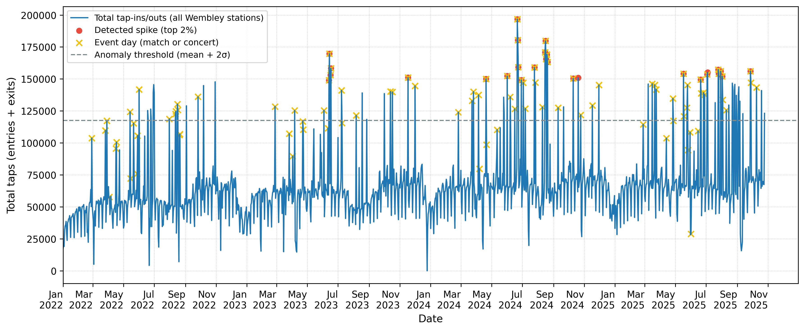

# Wembley Transport and Business Analytics

UCL business analytics coursework investigating event-related demand at Wembley Park, Wembley Central and North Wembley stations. The business question is how football matches and concerts relate to station demand and what a hypothetical shuttle service could mean for crowding.

## Technologies and methodology

Python, pandas, NumPy, statsmodels and matplotlib, with Excel input via openpyxl. The notebook aggregates entry/exit taps to daily station flows, joins event calendars and wider transport demand, and fits OLS regressions of log flows with event indicators, lagged demand, weekend controls and a weekend-match interaction. Visual analysis compares event types, stations and spikes relative to a rolling baseline.

## Findings and scenario interpretation

The supplied [figures](Graphs/) document event/non-event comparisons, station demand spikes and actual versus fitted flows. They support examining demand around event dates; no verified numerical regression results remain in the cleared notebook outputs.

The shuttle scenario imposes a **20% reduction** in event-day taps. This is an illustrative input assumption, not an observed reduction, a causal estimate or a delivered business outcome. A lower simulated flow follows from that assumption.



## Start here

- [Analysis notebook](TFL_final.ipynb): data preparation, regressions, plots and scenario calculations.
- [Figures and business model visual](Graphs/): retained aggregate project outputs.

## How to run

```bash
python -m venv .venv
# Activate the environment, then:
python -m pip install jupyterlab pandas numpy statsmodels matplotlib openpyxl
python -m jupyterlab
```

Open `TFL_final.ipynb` from the repository root. Supply the original files, under the provider's access terms, at the paths used in the notebook:

- `StationFootfall_2022_2025.csv`
- `wembley_matches_2021_2025.xlsx`
- `wembley_concerts_2022_2025.csv`
- `Journeys_2024_2025 .csv` (the original filename includes a space before `.csv`).

The notebook expects the original schemas, including station entry/exit counts, event dates and Tube/Bus journey counts. These prepared source files are not included; downloading arbitrary TfL files alone may not reproduce their schema. Adjust paths if storing data elsewhere. Dependencies are not version-locked, and full execution was not repeated during publication.

## Limitations and authorship

Observational regressions do not establish causality; daily totals do not resolve event-time crowding. Missing data coverage, temporal dependence and in-sample fitted plots limit predictive interpretation. `Shuttle_t` is derived from the event indicators and can create collinearity in the scenario regression. Costs, capacity, passenger choice and operational feasibility require independent validation. The supplied materials do not establish individual task allocation; this portfolio snapshot does not claim exclusive authorship of the coursework. Raw source data and restricted teaching materials are excluded.
